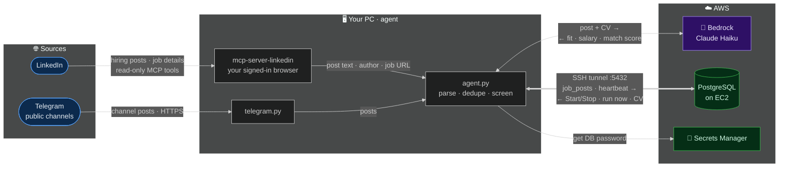
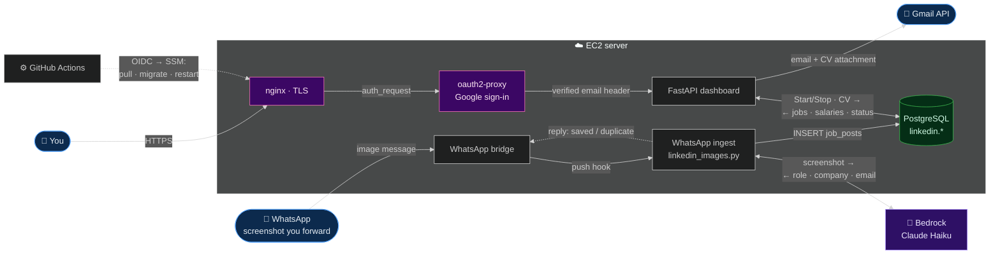
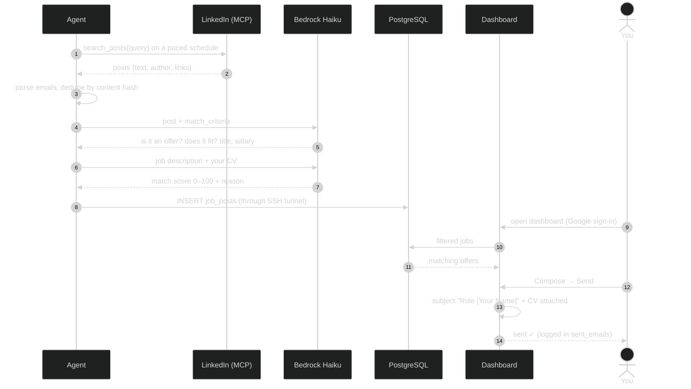

# linkedin-jobs-scraper

Collects LinkedIn hiring posts that match the roles you are looking for, screens them with an LLM, and shows them
in a small web dashboard where you can review each post and email the poster directly.

## Architecture

### 1 · Collection — runs on your PC

The agent uses your own signed-in browser, so LinkedIn sees a normal user session. Every arrow is labelled with the data it carries.

### 2 · Server — dashboard, WhatsApp ingest, deploy

### 3 · Life of one post

**Design notes**

- **Read-only on LinkedIn.** The agent can only call the tools in `ALLOWED_TOOLS`; it never posts, likes, or messages.
- **No inbound ports on the agent.** It reaches the database through an outbound SSH tunnel as a restricted user that can only forward to `127.0.0.1:5432`.
- **Push, not polling, for WhatsApp.** The bridge pushes each new image to the ingest hook; there is no loop scanning for messages.
- **Secrets stay out of git.** The DB password comes from Secrets Manager, Gmail credentials from a one-time OAuth login on the server.

## Folders

| Folder | What |
|---|---|
| [`agent/`](agent/) | Scraper agent that runs on a home or office PC, using your own signed-in LinkedIn browser session via [`mcp-server-linkedin`](https://pypi.org/project/mcp-server-linkedin/). **[Setup →](agent/README.md)** |
| [`dashboard/`](dashboard/) | FastAPI dashboard (status, Start/Stop, jobs grid, compose & send) behind Google sign-in (oauth2-proxy) |
| [`db/`](db/) | Postgres schema `linkedin` (migrations applied on every deploy) |
| [`deploy/`](deploy/) | Server setup and the deployer run by GitHub Actions |
| [`whatsapp/`](whatsapp/) | Optional: turns LinkedIn screenshots sent to a WhatsApp number into job posts |

## Configuration

- **Search & screening:** edit [`agent/config.json`](agent/config.json) — search queries, pacing, active hours,
  and `match_criteria` (plain-language description of the roles you want). Machine-specific overrides go in
  `agent/config.local.json` (git-ignored).
- **Email signature:** set your name and phone numbers in `ME` in `dashboard/static/index.html`, and
  `MAIL_FROM_NAME` / `GMAIL_USER` / `MAIL_ALLOWED_USERS` in the server environment.
- **Deploy (optional):** the GitHub Actions workflow deploys over AWS SSM using OIDC. Set repository variables
  `AWS_DEPLOY_ROLE_ARN`, `AWS_REGION` and `EC2_INSTANCE_ID`; without them the deploy job is skipped.
- **Secrets** are never stored in the repo: the database password comes from AWS Secrets Manager
  (`db.secret_id` in the agent config) or `/etc/jobsscrap/env` on the server; Gmail credentials from
  `deploy/gmail-oauth-login.py`.

## Responsible use

This tool automates a browser session that you are signed into. Use it only with your own account, at a gentle
pace (the defaults deliberately space requests minutes apart and cap daily searches), and in line with
LinkedIn's User Agreement and the privacy rights of the people whose posts you collect. The agent is restricted
to read-only tools (`ALLOWED_TOOLS` in `agent/agent.py`). You are responsible for how you use it.

## License

[MIT](LICENSE)
