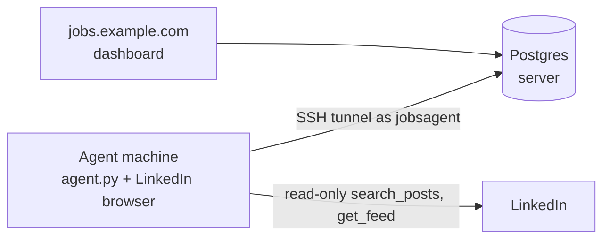

# Running the scraper agent on another machine

Instructions for moving (or adding) the LinkedIn scraper **agent** to a new Windows machine, e.g. a PC in another country.
Written so a person or an AI coding agent can follow it step by step.

## How it fits together



- The agent searches LinkedIn through the MCP server `mcp-server-linkedin` (pinned to `4.26.0`) and saves posts to Postgres.
- The dashboard at https://jobs.example.com reads the same database. Start, Stop and Test run are pressed there.
- The agent reaches the database through an SSH tunnel as the restricted user `jobsagent`. That user can only forward to `127.0.0.1:5432`. It has no shell and no other ports.
- **Only one agent drives LinkedIn at a time.** An agent holds a lease through its heartbeat. A second agent waits on standby until the first has been silent for 90 seconds.

## Rules (protect the LinkedIn account)

1. **Home or office internet only.** Never run the agent on a cloud VM (AWS, Azure, GCP), because LinkedIn flags data-centre IPs.
2. **One agent at a time.** Stop the old agent before relying on the new one. The lease prevents overlap, but don't leave two machines fighting over it.
3. **Read-only.** The agent may only call `search_posts`, `get_feed`, `get_person_profile`, `search_people` and `get_job_details` (`ALLOWED_TOOLS` in `agent.py`). Never add messaging, connecting, posting or reacting. Feed scrolls save only hiring posts that mention a role in `feed_browse.roles`, labelled `(home feed)`. Now and then it reads the recent posts of a recruiter (author of a matching hiring post linked to Saudi Arabia, or a Saudi-based tech recruiter found by people search into `linkedin.recruiters`; `profile_visits` and `recruiter_search` cap how often), labelled `(recruiter profile)`. People searches count toward `max_searches_per_day`.
4. **Don't speed it up.** Keep the gaps, daily cap and active hours in `config.json` unless the account owner agrees.
5. **Stop at the first warning.** On a captcha, checkpoint or "unusual activity" page, the agent stops itself. Do not retry. Sign in manually and tell the account owner.
6. **Never commit secrets.** `agent/.db_password`, `agent/config.local.json`, `agent/raw/` and `agent/agent.log` are git-ignored. Keep it that way.

## Prerequisites

- Windows 10 or 11, with the OpenSSH client (built in).
- [uv](https://docs.astral.sh/uv/getting-started/installation/): `powershell -c "irm https://astral.sh/uv/install.ps1 | iex"`
- [Git](https://git-scm.com/), and a clone of this repository.
- The `linkedin_scraper` database password. Get it from the admin over a private channel. Never paste it into chat, email or tickets.

## Steps on the new machine

### 1. Clone the repo and run the setup script

```powershell
git clone https://github.com/m86hussein/linkedin-jobs-scraper C:\SourceCode\linkedin-jobs-scraper
cd C:\SourceCode\linkedin-jobs-scraper
powershell -ExecutionPolicy Bypass -File agent\setup-agent.ps1 -InstallTask
```

[`setup-agent.ps1`](setup-agent.ps1):
- creates the SSH key `~/.ssh/jobsagent_ed25519` (no passphrase, so the agent can start unattended);
- asks for the DB password and stores it in `agent\.db_password`, readable only by the current Windows user;
- writes `agent\config.local.json` (machine name, SSH user and key, password file);
- with `-InstallTask`, registers the scheduled task **LinkedInJobsAgent**, which starts the agent at logon and restarts it if it crashes;
- prints the machine's **public IP** and **public key**.

### 2. Send the public IP and public key to the admin

The admin runs the steps in [Admin: enable a new machine](#admin-enable-a-new-machine). Until then the SSH tunnel is refused.

### 3. Sign in to LinkedIn once on this machine

```powershell
uvx mcp-server-linkedin==4.26.0 --login --login-timeout 0
```

A browser window opens. Sign in as the scraper's LinkedIn account and complete any 2FA or captcha there. The session is saved in `%USERPROFILE%\.linkedin-mcp\profile`.

Check it:

```powershell
uvx mcp-server-linkedin==4.26.0 --status
```

### 4. Stop the old agent, start this one

1. On the **old** machine, stop the agent (close its terminal, or `Stop-ScheduledTask LinkedInJobsAgent`).
2. On the **new** machine:
   ```powershell
   cd C:\SourceCode\linkedin-jobs-scraper\agent
   uv run --with-requirements requirements.txt python agent.py
   ```
   Or, if you used `-InstallTask`: `Start-ScheduledTask LinkedInJobsAgent`.

### 5. Verify on the dashboard

Open https://jobs.example.com. Within about 90 seconds the **Scraper** panel should show:

- **agent online**
- **Agent host / IP**: this machine's name and its public IP
- **Activity**: `agent online on <NAME> (<IP>) as LinkedIn ...`

Press **Test run** (5 minutes or 100 posts), then check that posts appear.

## Day-to-day

| Task | How |
|---|---|
| Start / stop scraping | Dashboard buttons. The agent obeys within about 15 seconds. |
| Change searches or pacing | Edit `agent/config.json`, commit and push. The agent re-reads it at the start of each run; `git pull` on the agent machine. |
| Logs | `agent\agent.log` |
| Raw LinkedIn responses (debugging) | `agent\raw\*.json` |
| Update the code | `git pull`, then restart the agent (`Stop-ScheduledTask` / `Start-ScheduledTask LinkedInJobsAgent`) |
| Run on macOS | `agent/install-macos.sh` installs a launchd agent (starts at login, restarts if it exits). Restart: `launchctl kickstart -k gui/$UID/com.github.linkedin-jobs-scraper.nkedin-agent`. Remove: `launchctl bootout gui/$UID/com.github.linkedin-jobs-scraper.nkedin-agent`. The Mac must stay awake during active hours. |

## Troubleshooting

| Symptom | Cause / fix |
|---|---|
| `connection problem ... ssh tunnel exited` in the log | The public IP changed (common on home internet), or the key isn't enabled yet. Re-run step 2 with the new IP. |
| `standby: agent X (IP) is active` | Another machine holds the lease. Stop it, and this one takes over after 90 seconds. |
| Dashboard shows **blocked** | LinkedIn showed a checkpoint. Run `--login` again (step 3), sign in by hand, then press Start. |
| `incorrect passphrase` for the SSH key | The key was made with a passphrase. Delete `~/.ssh/jobsagent_ed25519*` and re-run the setup script. |
| JSON error reading `config.local.json` | Re-run the setup script. The agent accepts UTF-8 with or without a BOM. |

## Admin: enable a new machine

Needs the server's admin SSH key and an AWS CLI profile for the account that hosts the server.

```powershell
$ip  = '<PUBLIC_IP>'           # from setup-agent.ps1 output
$pub = '<ssh-ed25519 AAAA... jobsagent@NAME>'

# 1. Allow SSH from that IP (the server's security group)
aws ec2 authorize-security-group-ingress --profile <aws-profile> --region <aws-region> `
  --group-id <security-group-id> `
  --ip-permissions "IpProtocol=tcp,FromPort=22,ToPort=22,IpRanges=[{CidrIp=$ip/32,Description=jobsagent-$($pub.Split(' ')[-1])}]"

# 2. Add the key for jobsagent, restricted to the Postgres tunnel
"restrict,port-forwarding,permitopen=`"127.0.0.1:5432`",command=`"/usr/sbin/nologin`" $pub`n" -replace "`r","" |
  ssh -i $HOME\.ssh\<admin-key> ubuntu@<server-ip> "sudo tee -a /home/jobsagent/.ssh/authorized_keys >/dev/null"
```

To retire a machine, delete its line from `/home/jobsagent/.ssh/authorized_keys` and revoke its IP with `aws ec2 revoke-security-group-ingress` (same arguments).
